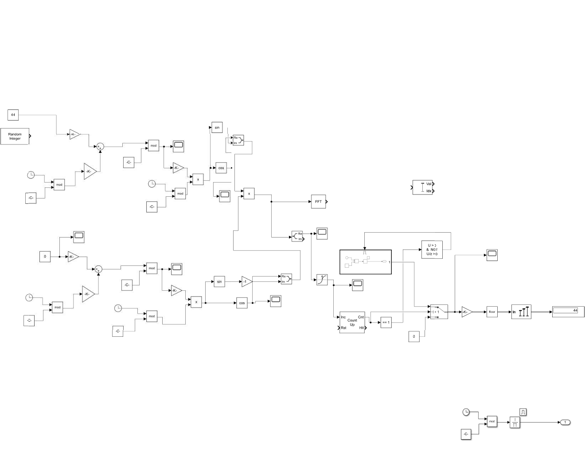
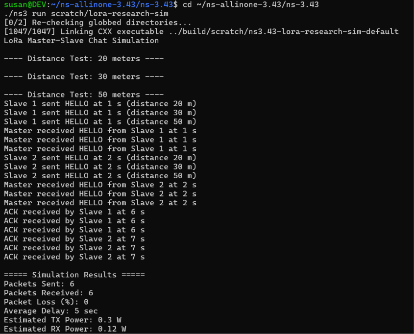

# LoRa-style master and slave simulation (NS-3)



A small NS-3 simulation of a master node and two slave nodes sending short messages over distances of 20, 30 and 50 metres. The long-term goal is a low-power, long-range campus chat where nodes take turns using a token, so they never transmit at the same time.

## Where this stands

This repo is an early step toward that goal. It is **not** a LoRaWAN simulation and it does **not** implement token passing yet. It uses plain NS-3 core, network and mobility modules, not the NS-3 `lorawan` module.

What the code in `lora-research-sim.cc` does today:

- Slave 1 sends a HELLO at 1 s and slave 2 sends one at 2 s, for each of the three test distances.
- The HELLO arrives after the propagation delay (distance divided by the speed of light).
- The master answers each HELLO with an ACK 5 seconds after it receives it.
- At the end it prints packets sent and received, loss, the average delay, and an estimated power figure (fixed constants of 0.05 W per packet sent and 0.02 W per packet received, not a measurement).
- The three distance tests are all scheduled at the same simulated times (1 s and 2 s), so they overlap instead of running one after another.

Because there is no radio or channel model, packet loss is always 0% and the average delay is just the 5 second ACK delay plus a propagation delay of under 200 nanoseconds. Treat the numbers as a check that the event flow works, not as a result about LoRa.

`chirp2.mdl` is a separate Simulink model of LoRa chirp (CSS) signal generation and FFT analysis. It is not connected to the NS-3 code.

## Run the NS-3 simulation



```bash
cd ~/ns-allinone-3.43/ns-3.43
cp lora-research-sim.cc scratch/
./ns3 run scratch/lora-research-sim
```

## Run the Simulink model

1. Open MATLAB (R2021a or later) and open `chirp2.mdl`.
2. Run the model to see chirp generation, modulation and the FFT analysis.

## Sample output

| Metric | Value |
|---|---|
| Packets sent | 6 |
| Packets received | 6 |
| Packet loss | 0% |
| Average delay | about 5 s (the ACK delay) |
| Estimated TX power | 0.3 W (6 x 0.05) |
| Estimated RX power | 0.12 W (6 x 0.02) |

## Next steps

- Implement the token itself: only the node holding it transmits, then it passes to the next node.
- Add a real channel model so range, loss and collisions mean something.
- Try the NS-3 `lorawan` module for the physical layer.
- Support more than two slaves, and handle a node that dies while holding the token.
